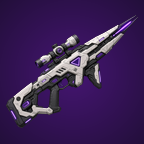

# WePlay: Shock Lance

An energy rifle for Factorio 2.1 with glowing bolts and a slow plasma orb. Hit the orb with a bolt for a huge shock combo explosion.

## How it works

- **Primary fire:** the normal shoot button fires a short glowing bolt that flies up to 40 tiles and hits the first enemy in its path (electric damage).
- **Alt fire:** **right-click** (or press **G**) with the Shock Lance selected to launch a slow plasma orb. It bursts on the first enemy it touches.
- **Careful:** with friendly fire on (the default), combo and orb blasts hurt everything friendly in range, including you, your teammates and your buildings.
- **Shock combo:** hit a flying orb with a bolt and it detonates in a big shockwave.
- **Powered by your armor**, no ammo. The lance has a small internal capacitor (10 MJ) that fills from your suit's spare generator output, so generator-only suits work too. Shots spend the capacitor first, then your armor's batteries.
  - 100 kW while the Shock Lance is your selected gun
  - 1.5 MJ per bolt or orb
  - 5 MJ per shock combo (without enough charge, the orb just pops)
- The capacitor only fills while the Shock Lance is your selected gun, and only from power that would otherwise go to waste (your batteries and other equipment are served first).
- The bar under the Shock Lance's ammo slot in the weapons panel shows your charge level (capacitor plus batteries).
- The gun won't fire when the capacitor and batteries together can't cover a shot.
- Unlocked by the **Shock Lance** technology (after Laser and Military 3). Laser damage and laser shooting speed research boost it too.
- **Map settings** (changeable mid-game): plasma orb diameter (default 2 tiles), orb travel distance (default 100 tiles; bolts always reach at least this far), shock combo explosion radius (default 7 tiles), and a damage multiplier (1x to 4x, applies to bolts, orbs and combos), a friendly fire toggle, and a toggle for combos clearing trees, rocks and grass in the blast.
- Space Age is optional.

## Install

Install from the Factorio mod portal: https://mods.factorio.com/mod/WePlayShockLance

## License

The code is released under the Unlicense (public domain). See LICENSE.
